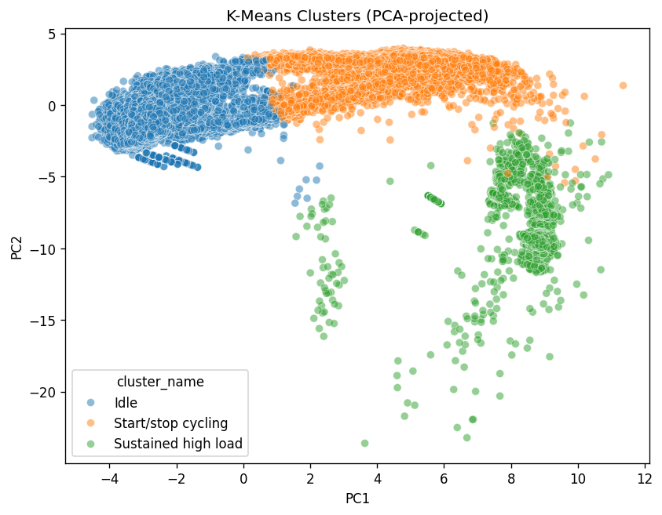
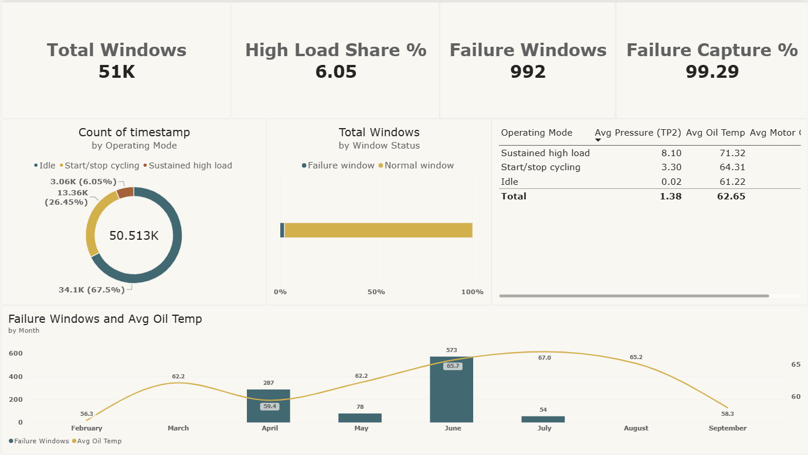

# Where do compressor failures happen? Clustering MetroPT-3 sensor data

Metro trains rely on an air compressor for braking and doors, and a failure disrupts service. With only four recorded failures in seven months, there is too little to train a failure detector. So I asked a smaller question: if I group the compressor's sensor readings by how it is operating, do the failures concentrate in one of the groups?

Live app: <add Streamlit link>

## Short answer

Yes, mostly. One operating mode, sustained high load, makes up 6.05% of the time but contains 985 of the 992 failure windows (99.3%). The catch is that only about 1 in 3 windows in that mode is a failure, so the finding describes where failures happen but cannot work as a warning.

## How I got there

- **Data:** MetroPT-3, one compressor on a Metro do Porto train, about 1.5 million readings from 15 sensors, one roughly every 10 seconds, February to August 2020. I used the [Kaggle copy](https://www.kaggle.com/datasets/joebeachcapital/metropt-3-dataset), where its terms of use are listed. The raw CSV (about 218 MB) is not in this repo; to rerun the notebooks, put it at `data/raw/MetroPT3(AirCompressor).csv`.
- **Windows:** I cut the data into 5-minute windows and described each with 36 numbers (mean, standard deviation, min and max for 7 continuous sensors, plus the mean of 8 on/off signals). Windows with fewer than half the expected readings were dropped, leaving 50,513.
- **Clustering:** After scaling, K-Means with K=3. It never saw any failure information.
- **Check afterwards:** I compared the clusters with the four failure periods from the maintenance log. A window counts as a failure window if it overlaps any part of a failure period.
- **Naming the clusters:** from their own averages. Highest motor current is "Sustained high load", lowest pressure is "Idle", and the remaining one is "Start/stop cycling".

## Results

| Mode | Share of windows |
|---|---|
| Idle | 67.5% |
| Start/stop cycling | 26.45% |
| Sustained high load | 6.05% |

- 992 failure windows in total, about 1.96% of all windows.
- 985 of them (99.3%) fall in sustained high load, about 16 times the overall failure rate.
- 985 of the 3,056 windows in that mode (32.2%) are failure windows.
- Silhouette is 0.43 for K=3, 0.41 for K=2 and 0.34 for K=4. K=3 is only slightly ahead of K=2; I chose it because the three groups are easy to interpret.



The numbers come from `results/metrics.json`.

I also built a Power BI dashboard on the windows file. The `.pbix` is not in the repo, only the screenshot.



## What I can't conclude

- Four failures on one compressor is a small sample, so this is not a general result.
- Each failure is labeled for its full duration, so late-stage windows count too.
- High load might be a symptom of the leak rather than an early sign. The compressor may run harder because air is escaping.
- At roughly 1 in 3 precision this would not work as an alarm. Predicting failures would need labels for the period before each failure and testing on failures the model has not seen.
- The 50% completeness cutoff was my choice and I did not test other values.

## Running it

```
pip install -r requirements.txt
```

Add the raw CSV, run `notebooks/01_eda_cleaning.ipynb` then `notebooks/02_windowing_clustering.ipynb`, and start the app with `streamlit run app/app.py`.

```
app/app.py              Streamlit app
data/                   raw CSV (not in repo) and processed files
notebooks/              cleaning and EDA, windowing and clustering
reports/figures/        figures and dashboard screenshot
results/metrics.json    numbers quoted above
```